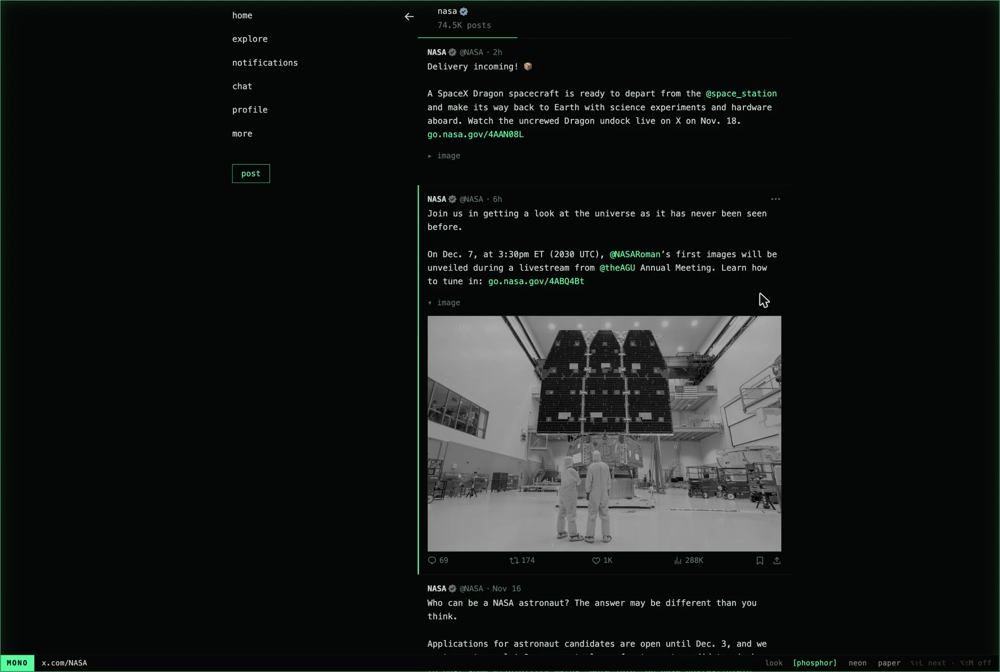

# Mono

A quiet way to read X. Mono is a small browser extension for Safari and Chrome that reduces x.com to text, one colour and a hairline around the page.

**[yask.dev/mono](https://yask.dev/mono)**



## What it does

- Removes the right column (trends, news, live, who to follow), promoted posts, the floating Grok and chat drawers, and the nudges to load more.
- Hides reply, repost, like and view counts until you point at a post.
- Reduces the nav to six words: home, explore, notifications, chat, profile, more.
- Turns the composer into a blank page: one monospaced column and a block cursor.
- Draws one hairline around the page and a status line at the bottom, where you switch looks.

"Off" is always the untouched site.

## Looks

| Look | Type | Colour | Pictures |
|---|---|---|---|
| `phosphor` | Monospace throughout | Near-black, one green | No avatars; media folds to a `▸ image` line you click to open |
| `neon` | System sans with monospace details | Blue-black, cyan-to-magenta edge | Grey until you point at them |
| `paper` | Monospace throughout | Warm paper, ink, one vermilion | Grey until you point at them |

## Keys

| Key | Does |
|---|---|
| `⌥⇧M` | Mono on or off |
| `⌥⇧L` | Next look |
| Click `▸ image` | Open a folded picture; click the line again to fold it |

You can also click `MONO` or a look name in the status line, or use the toolbar button.

## Install

### Chrome, Arc, Brave, Edge

```sh
git clone https://github.com/yask123/mono
```

Open `chrome://extensions`, turn on **Developer mode**, choose **Load unpacked** and pick the `mono/extension` folder.

### Safari

Safari only loads an extension that is wrapped in a Mac app, so for now you build that app yourself. You need Xcode.

With an Apple developer team:

```sh
git clone https://github.com/yask123/mono
cd mono
DEVELOPMENT_TEAM=YOURTEAMID scripts/build-safari.sh
```

Then open Safari → Settings → Extensions, tick **Mono**, and allow it on x.com.

Without a team, open `safari/Mono/Mono.xcodeproj` in Xcode and press Run. Safari will only load that build after you turn on **Allow unsigned extensions** in Settings → Developer, and it asks again each time Safari restarts.

## How it is put together

```
extension/
  looks.css      a look is a set of --m-* variables on <html data-mono="…">, plus the frame and status line
  sites/x.css    the recipe for x.com; it reads only those variables
  content.js     sets the look, draws the status line, tags media so a look can fold it
  popup.html     the toolbar button
safari/Mono/     the Xcode project that wraps extension/ for Safari
site/            the page at yask.dev/mono
```

A recipe hooks onto `data-testid`, `role` and `aria-*` attributes, which X keeps fairly stable. When X changes its markup a rule can stop matching; the fix is usually one selector in `sites/x.css`.

Adding a look means adding one block of variables to `looks.css` and its name to `LOOKS` in `content.js` and `popup.html`. Adding a site means a new file in `sites/` and an entry under `content_scripts` in `manifest.json`.

## Limits

- Only x.com has a recipe.
- Messages, settings and profile headers get the colours and type but no dedicated cleanup.
- Safari cannot draw a block text cursor, so Mono draws one for the composer. Chrome uses its own.
- Labels in the nav are matched by their English names.

## Licence

MIT. Mono is not affiliated with X Corp. The pictures on the page and in this README show NASA's public timeline.
